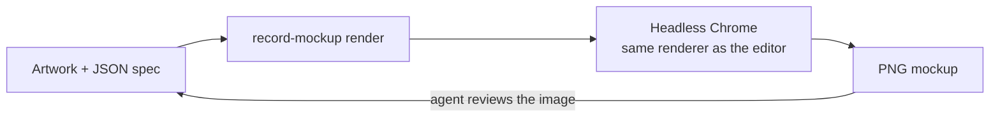

# Record Mockup — 3D Vinyl & LP Mockup Generator

**English** · [简体中文](README.zh-CN.md)

Record Mockup renders photorealistic **3D vinyl record mockups**: LP jackets, gatefolds, 2LP sets, shrink wrap, hype stickers, obi strips and limited-edition numbers. Use it in the browser to build a release visual by hand, or drive the same renderer from a JSON scene spec through a CLI that AI coding agents can operate.

**[Try it in your browser →](https://recordmockup.com/)** No install or sign-up needed; your artwork never leaves your machine.


<sub>All images in this README are rendered by Record Mockup from its built-in sample artwork. Specs live in [`docs/specs/`](docs/specs/).</sub>

## What it renders

| Gatefold spreads | Back covers | Coloured vinyl |
|---|---|---|
|  |  |  |
| Inner artwork and an adjustable opening angle | Obi strip, shrink wrap glare and a stamped edition number | Black, coloured or translucent, set per disc |


<sub>Pattern vinyl: a translucent splatter disc and a pinwheel disc, from [`docs/specs/patterns.json`](docs/specs/patterns.json).</sub>

- **Jackets:** single sleeve or gatefold at real 12″ dimensions (314 × 314 mm), matte, satin or gloss paper, printed front, back, spine and inner spread.
- **Formats:** 12" LP (314 mm jacket, 302 mm disc) or 7" single (`format: "7in"`: 184 mm jacket, 175 mm disc at 45 rpm, with an optional 38 mm large centre hole).
- **Records:** 1LP or 2LP, grooves with track gaps, A/B/C/D labels, 1–20 tracks per side, black, coloured or translucent vinyl per disc, inner sleeves and a double-sided insert that slide out of the jacket. A gatefold 2LP puts one record in each panel, or stacks both in the right panel.
- **Disc only:** switch the scene to the record alone, vinyl and labels with nothing else in frame, to design the disc itself; on 2LP pick which disc to show (`scene.mode: "disc"`).
- **Picture discs:** artwork printed under clear vinyl on each side (`vinyl: "picture"`, `images.pictureA`…`pictureD`), printed right to the spindle hole or round an optional paper label.
- **Filled vinyl and glitter:** liquid-filled patterns (rounded blobs and droplets in one colour and a shade of it, carried round as the disc spins), sand, and glitter, picked like any other pattern.
- **Vinyl colours and patterns:** plain black, or a coloured disc with 0–80% transparency. Coloured discs can carry a pattern: splatter, blob, swirl, pinwheel, ripple, starburst, smoke or marble, or split colours in halves, thirds or quarters. Pick the colours yourself or take them from the cover. On a 2LP, disc 2 matches disc 1 unless you style it separately.
- **Album lookup:** search MusicBrainz and the Cover Art Archive by artist and album (artist aliases included, so English names find CJK credits), pick a 12″ vinyl release, and send any of its images to any artwork slot. Record count, gatefold and tracks per side are filled in, disc photos are cropped into side labels, and the cover defaults to the album's digital release artwork. Your own uploads stay unless you replace them.
- **Retail details:** crinkled shrink wrap with studio reflections, a hype sticker on the wrap (round, rectangular or square artwork, or one of 10 editable templates), a Japanese-style obi strip, and limited-edition numbers (print, rubber stamp, hot foil or handwriting, any font).
- **Output:** PNG up to 4096 px with a transparent or solid background, preset camera angles plus orbit, zoom and pan.

Typical uses: pre-order announcements, store and Bandcamp listings, label catalogues, social posts and pitch decks for a pressing.

## Two ways to use it

**Browser editor.** `index.html` is a single-page editor: upload artwork, switch formats, pull records out, orbit the camera and export a PNG, or play an animation on the stage (turntable, swing, record spin, gatefold opening, pull-out) and export it as an MP4 or GIF in 16:9, 1:1 or 9:16. Images are processed locally in the browser and are not uploaded anywhere. The scene, including uploaded artwork and font, is saved in this browser (localStorage for settings, IndexedDB for files) and comes back after a reload; **New** clears it. Below 860 px wide the editor fits one phone screen, with the settings pages on bottom tabs.

**CLI and agents.** `cli/record-mockup.mjs` opens the same page in headless Chrome and drives it through `window.recordMockup`, so the CLI output matches the editor exactly. Every option is a field in a JSON scene spec with a published JSON Schema, which makes the tool easy for AI agents such as Codex or Claude Code to operate: write a spec, render, look at the PNG, adjust, render again.



## Requirements

- Node.js 20 or later.
- Google Chrome, or Playwright's Chromium.
- Network access for the first `npm` install.

## Install

```bash
npm ci --prefix cli
```

The CLI uses your installed Chrome by default. Without Chrome:

```bash
cd cli
npx playwright-core install chromium
cd ..
```

Then add `--browser chromium` to CLI commands.

## Quick start

```bash
mkdir -p output
node cli/record-mockup.mjs schema -o output/schema.json
node cli/record-mockup.mjs slots examples/2lp-gatefold.json
node cli/record-mockup.mjs render examples/2lp-gatefold.json -o output/example.png --json --strict
```

The example uses the renderer's built-in sample artwork, so no album art is needed.

To start your own scene:

```bash
node cli/record-mockup.mjs init -o output/spec.json
```

Keep the images next to the spec and reference them by relative path. Register the source of every custom image under `meta.assets.<slot>.source`: `user`, `generated`, `typeset`, `composite` or `sample`; images taken from the editor's album lookup are recorded as `fetched`. For generated images, also record the prompt.

```json
{
  "images": {"front": "cover.jpg"},
  "records": {
    "count": 2,
    "disc1": {"vinyl": "color", "color": "#f2d9a6", "transparency": 45,
              "pattern": {"id": "splatter-05", "color": "#1f3fa8"}},
    "disc2": {"sameAsDisc1": false, "vinyl": "color", "color": "#e2572f",
              "pattern": {"id": "pinwheel-02", "color": "#f4e7c9"}}
  },
  "number": {"current": 88, "total": 500, "place": "front", "finish": "foil"},
  "camera": {"view": "quarter", "zoom": 0.9},
  "output": {"background": "transparent", "width": 2400, "height": 1600},
  "meta": {
    "assets": {
      "front": {"source": "user", "note": "Cover supplied by the label"}
    }
  }
}
```

Units follow the editor: millimetres for lengths, percent for how far things are pulled out, degrees for angles.

Vinyl is set per disc under `records.disc1` and `records.disc2`. `vinyl` is `black` (plain, opaque, no pattern) or `color`, which uses `color` and `transparency` (0–80%). `pattern.id` adds a pattern on top of a coloured disc, with `color` as the base. Split patterns (`split-half`, `split-tri`, `split-quad`) use `pattern.color` for the second section and `pattern.color2` for the third in `split-tri`. Most other patterns use `pattern.color` as the pattern colour and derive the remaining tones; the tonal ones (`ripple-01`, `starburst-04`, the `smoke-*` and `marble-*` patterns) only shade the base colour, with `pattern.contrast` setting how strong. `pattern.rotation` turns the pattern, and `pattern.fromCover: true` takes the colours from `images.front`, with any colours you write winning. `transparency` is the base colour's; main + accent patterns can also take `pattern.transparency` (0–80%, default 0) to make the pattern itself see-through. Split and tonal patterns have no separate pattern transparency and give a warning if one is set. Disc 2 copies disc 1 by default (`records.disc2.sameAsDisc1: true`); writing any of its vinyl, colour or pattern fields styles it separately. Run `schema` for the full list of pattern ids. `records.discN.tracks` sets the tracks per side (1–20, default 6). On a gatefold 2LP, `records.layout` is `split` (default: disc 2 sits in the left panel and slides out to the left) or `stacked` (both discs in the right panel). The older value `"clear"` still works and means `color` with 38% transparency.

A picture disc is `vinyl: "picture"`: side A shows `images.pictureA` and side B `images.pictureB` (disc 2: `pictureC` / `pictureD`), square images with the disc filling them; side B repeats side A until it has its own. There is no paper label unless `picture.paperLabel` is `true`, so the side labels don't show. Colour, transparency and pattern don't apply.

Liquid, sand and glitter are patterns too (`liquid-01`…`liquid-03`, `sand-01`, `glitter-01`, `glitter-02`). Liquids are tonal: one `color` and a shade derived from it (`pattern.contrast` sets how far), in a shell that is always clear, so they take no `transparency`. `liquid-01` is blobs of both in clear liquid, `liquid-02` light blobs in a full cavity of the colour, `liquid-03` a full cavity crowded with droplets. Sand and glitter are main + accent: two sand colours (no transparency either); glitter takes `color` and `transparency` for the vinyl and `pattern.color` for the flakes.

## Commands

Run `node cli/record-mockup.mjs --help` for every option. See also [`cli/README.md`](cli/README.md).

| Command | What it does |
|---|---|
| `schema` | Prints the JSON Schema: every field with its unit, range and default |
| `init` | Writes a spec with default values |
| `slots [spec.json]` | Lists artwork slots for that scene: pixel size, visible area, what covers it, and whether to supply, generate or typeset it |
| `render spec.json` | Renders one PNG |
| `numbers spec.json --from 1 --to 50` | Renders one image per edition number |
| `video spec.json -o turn.mp4` | Renders a looping clip as MP4 or GIF, set by `animation` in the spec: turntable, swing, record spin, gatefold opening or pull-out (16:9, 1:1 or 9:16). The editor's ▶ button previews the same motion on the stage |

Useful options: `--set path=value` overrides a field without editing the file, `--json` prints a one-line result, and `--strict` refuses to render when the spec or the source register produces warnings.

Exit codes: `0` done, `1` error, `2` warnings under `--strict`.

## Filling in missing artwork

When only a front cover is available, [`AGENTS.md`](AGENTS.md) describes how an agent completes the rest. It inventories slots with `slots`, extracts a style card from the cover, generates text-free backgrounds with an image model using [`prompts/image-prompts.md`](prompts/image-prompts.md), typesets text such as tracklists in code, renders, reviews and records every asset's source in `meta.assets`.

Hype stickers rarely need artwork: `sticker.template` picks one of the built-in templates (`schema` lists them), `sticker.lines` sets each line of text and `sticker.color` the colours. For a sticker the templates don't cover, lay it out as a 1024 × 1024 HTML page and turn it into a PNG for `images.sticker` with `node tools/typeset-sticker.mjs sticker.html`.

Record Mockup never generates a real release's front cover, and generated companion artwork is labelled as illustrative.

## Browser editor and network use

The editor is published at <https://recordmockup.com/> on every push to `main` that touches the page (`.github/workflows/pages.yml` runs `node site/build.mjs`, which adds the document head, search and sharing metadata, favicon, robots.txt and sitemap). Pull requests that touch the page or its assets also get a noindex preview on Cloudflare Pages (`.github/workflows/preview.yml`), with the link posted on the PR.

To run it locally, serve the page, for example from the project root:

```bash
python3 -m http.server 8000 --bind 127.0.0.1
```

Then open `http://127.0.0.1:8000`.

In the browser, three.js (and, for video export, Mediabunny and gifenc) load from pinned CDN versions, so the page needs network access. The CLI serves them from the locally installed packages instead. The album lookup calls musicbrainz.org and coverartarchive.org directly, only when you search; fetched images keep their owners' copyright and are for previews only. Google Fonts are still requested; if that fails, system fonts are used and type may look different. The CLI briefly listens on the loopback address, so the environment must allow a local server and a browser to start.

## Rebuilding the README images

```bash
node docs/build-images.mjs
```

This renders every spec in `docs/specs/`, writes JPEGs to `docs/images/`, and builds the 1280 × 640 `social-preview.png`.

## Verification

```bash
node --check cli/record-mockup.mjs
npm test --prefix cli
npm audit --prefix cli --omit=dev
```

The integration test starts a real headless browser and checks strict-mode exit codes and whether files are written. To use Chromium, run `GROOVE_TEST_BROWSER=chromium npm test --prefix cli`.

## FAQ

**Can I use my own album artwork?** Yes. Pass it in the browser or reference it in a spec. Images stay on your machine.

**Does it need a GPU?** No. The CLI uses the GPU when one is available (about 4–9 s per image) and falls back to software WebGL otherwise, which is roughly four times slower.

**Can I get a transparent background?** Yes. Set `output.background` to `"transparent"` and the shadow is kept.

**Which formats are covered?** 12″ LP single jackets and gatefolds, with one or two records. Coloured vinyl comes in splatter, blob, swirl, pinwheel, ripple, starburst, smoke and marble patterns, plus split colours in halves, thirds or quarters. Liquid-filled, sand-filled, glitter and picture discs are covered too; zoetrope picture discs are on the roadmap.

## Repository scope

This is a standalone Git repository. It tracks source code, documentation, lockfiles, example scenes and README images rendered from the built-in sample artwork. `output/`, dependencies, local tool settings, environment files and run reports are ignored and stay on your machine.

Deliverables in `output/` are not pushed with the source. Before distributing images, check the rights to the artwork and fonts they contain, then choose suitable storage.

## License

The project's original code and documentation are all rights reserved; no open-source license is granted. The source is visible for reference, but reuse or redistribution needs permission. See [`LICENSE`](LICENSE); third-party software, fonts and artwork are covered in [`THIRD_PARTY_NOTICES.md`](THIRD_PARTY_NOTICES.md).
