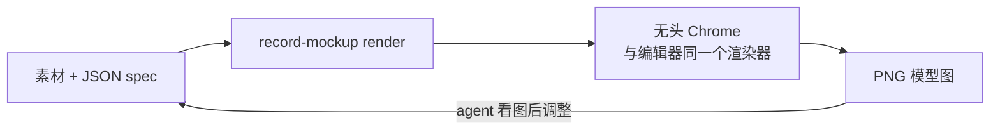

# Record Mockup：黑胶唱片 3D 模型图生成工具

[English](README.md) · **简体中文**

Record Mockup 用来渲染接近实拍效果的**黑胶唱片 3D 模型图**，支持单开封套、双开封套、2LP、塑封膜、hype sticker、Obi 侧标和限量编号。你可以在浏览器里手动调整出图，也可以写一份 JSON 场景描述（spec），交给命令行工具出图。这条命令行链路也适合 Codex、Claude Code 等 AI agent 操作。

**[在浏览器里直接试用 →](https://recordmockup.com/)** 无需安装或注册，素材不会离开你的电脑。


<sub>本页所有配图都由 Record Mockup 用内置示例图渲染，对应的 spec 在 [`docs/specs/`](docs/specs/)。</sub>

## 能做什么

| 双开内页 | 封套背面 | 彩胶 |
|---|---|---|
|  |  |  |
| 内页贴图，开合角度可调 | Obi 侧标、塑封反光、印章编号 | 黑胶、彩胶、半透明，每张单独设置 |


<sub>彩胶纹路：一张半透明飞溅胶、一张风车纹胶，spec 见 [`docs/specs/patterns.json`](docs/specs/patterns.json)。</sub>

- **封套**：单开或双开，按实物尺寸建模：12 寸 LP 为 314 × 314 mm，7 寸单曲为 184 × 184 mm（`format: "7in"`，唱片 Ø175 mm、45 转，可选 Ø38 mm 大孔）；纸张有哑光、缎面、亮面三种；可贴正面、背面、书脊和双开内页。
- **唱片**：单 LP 或 2LP，音槽带曲目间隙；A/B/C/D 面标签；每面 1–20 条音轨；每张唱片可选黑胶、彩胶或半透明；内袋和双面插页都能从封套开口抽出。双开 2LP 可以左右两扇各装一张，也可以两张叠在右扇。
- **只看唱片：** 场景里只留唱片本体（盘面和标签），其余全部不显示，用来单独设计盘面；2LP 时选择展示哪一张（`scene.mode: "disc"`）。
- **画胶**：每面一张图，印在透明胶层下（`vinyl: "picture"`，`images.pictureA`～`pictureD`），默认一直印到中孔，也可以在中间贴纸标。
- **液体胶、沙和亮片**：在纹路里选。液体胶有三种形态（清液里漂着色块、液体铺满漂着浅色块、铺满密集液滴），只选一个颜色，唱片转动时液体跟着转；还有沙和亮片。
- **胶色和纹路**：纯黑胶，或者彩胶（透明度 0–80%）。彩胶可以加纹路：飞溅、色块、漩涡、风车、波纹、星芒、烟雾、大理石，或者二分、三分、四分的分色。颜色可以自己选，也可以从封面取色。2LP 的第 2 张默认和第 1 张一样，也可以单独设置。
- **曲库检索**：按艺人和专辑名查 MusicBrainz 和 Cover Art Archive（支持艺人别名，英文名也能找到中日文艺人），选一个 12 寸黑胶版本，把其中任意图片用到任意贴图位。碟数、双开和每面音轨数自动填好，盘面照片自动裁成面标签，封面默认取专辑数字版的官方图。你自己上传的图默认保留。
- **零售细节**：带褶皱和影棚反光的塑封膜；贴在膜上的 hype sticker（上传圆形、长方形或正方形图片，或从 10 个文字可改的模板里选）；日式 Obi 侧标；限量编号（印刷、印章、烫金、手写四种工艺，字体可选，也可上传）。
- **输出**：PNG 最大 4096 px，背景可选透明或纯色；有预设视角，并支持环绕、缩放和平移。

常见用途：预售公告、店铺和 Bandcamp 商品图、厂牌目录、社交媒体宣传、压片提案。

## 两种用法

**浏览器编辑器**：`index.html` 是单页编辑器，可以上传素材、切换封套形式、抽出唱片、转动视角，然后导出 PNG；也可以在工作台播放动画（转台、摆动、唱片自转、双开展开、抽出），导出 16:9、1:1 或 9:16 的 MP4 或 GIF。图片只在浏览器本地处理，不会上传。当前场景（包括上传的图片和字体）保存在这个浏览器里（设置存 localStorage，文件存 IndexedDB），刷新后仍在；点「新建」清空。宽度小于 860 px 时，编辑器在手机上一屏放下，设置页的导航在底部。

**命令行和 agent**：`cli/record-mockup.mjs` 在后台用 Chrome 打开同一个页面，通过 `window.recordMockup` 接口驱动它，所以命令行出的图和编辑器完全一致。所有参数都是 JSON spec 里的字段，并有对应的 JSON Schema。agent 的操作方式就是：写 spec，出图，看图，调参数，再出图。



## 环境要求

- Node.js 20 或以上。
- Google Chrome，或者 Playwright 的 Chromium。
- 第一次安装 npm 依赖时需要联网。

## 安装

```bash
npm ci --prefix cli
```

默认使用本机的 Chrome。没有 Chrome 时：

```bash
cd cli
npx playwright-core install chromium
cd ..
```

之后给命令加上 `--browser chromium`。

## 快速开始

```bash
mkdir -p output
node cli/record-mockup.mjs schema -o output/schema.json
node cli/record-mockup.mjs slots examples/2lp-gatefold.json
node cli/record-mockup.mjs render examples/2lp-gatefold.json -o output/example.png --json --strict
```

这个例子用的是渲染器内置的示例图，不需要任何真实专辑封面。

自己新建一个场景：

```bash
node cli/record-mockup.mjs init -o output/spec.json
```

图片和 spec 放在同一个目录，路径写相对 spec 的路径。每张自定义贴图都要在 `meta.assets.<贴图位>.source` 登记来源，可选值为 `user`、`generated`、`typeset`、`composite`、`sample`；网页曲库检索取到的图为 `fetched`。生图素材还要记录提示词。

```json
{
  "images": {"front": "cover.jpg"},
  "records": {
    "count": 2,
    "disc1": {"vinyl": "color", "color": "#f2d9a6", "transparency": 45,
              "pattern": {"id": "splatter-05", "color": "#1f3fa8"}},
    "disc2": {"sameAsDisc1": false, "vinyl": "color", "color": "#e2572f",
              "pattern": {"id": "pinwheel-02", "color": "#f4e7c9"}}
  },
  "number": {"current": 88, "total": 500, "place": "front", "finish": "foil"},
  "camera": {"view": "quarter", "zoom": 0.9},
  "output": {"background": "transparent", "width": 2400, "height": 1600},
  "meta": {
    "assets": {
      "front": {"source": "user", "note": "厂牌提供的封面"}
    }
  }
}
```

单位和编辑器一致：长度用 mm，抽出程度用 %，角度用度。

胶色按张设置，写在 `records.disc1` 和 `records.disc2` 里。`vinyl` 为 `black`（纯黑胶，不透明，不叠纹路）或 `color`（彩胶，用 `color` 和 `transparency`，透明度 0–80%）。`pattern.id` 在彩胶上加纹路，底色是 `color`。分色类（`split-half`、`split-tri`、`split-quad`）用 `pattern.color` 作第二块，`split-tri` 再用 `pattern.color2` 作第三块。其他大多数纹路用 `pattern.color` 作纹路色，其余色层自动推算；同色系纹路（`ripple-01`、`starburst-04`，以及 `smoke-*`、`marble-*`）只用底色的深浅变化，`pattern.contrast` 调反差。`pattern.rotation` 旋转纹路；`pattern.fromCover: true` 从 `images.front` 取色，写明的颜色优先。`transparency` 是底色的透明度；主次类纹路可以再用 `pattern.transparency`（0–80%，默认 0）让纹路本身也变透明。分色类和同色系没有单独的纹路透明度，写了会给警告。第 2 张默认沿用第 1 张（`records.disc2.sameAsDisc1: true`）；写了它的胶色、颜色或纹路字段，就视为单独设置。完整的纹路列表用 `schema` 查看。`records.discN.tracks` 设每面音轨数（1–20，默认 6）。双开 2LP 用 `records.layout` 选分装方式：`split`（默认，第 2 张在左扇，向左抽出）或 `stacked`（两张叠在右扇）。旧值 `"clear"` 仍然可用，等于 `color` 加 38% 透明度。

画胶是 `vinyl: "picture"`：A 面显示 `images.pictureA`，B 面显示 `images.pictureB`（第 2 张用 `pictureC` / `pictureD`），方图，唱片铺满整张图；B 面没给时沿用 A 面。默认没有纸标，面标签不显示；`picture.paperLabel: true` 时中间贴纸标。画胶不使用颜色、透明度和纹路。

## 命令

完整参数见 `node cli/record-mockup.mjs --help` 和 [`cli/README.md`](cli/README.md)。

| 命令 | 作用 |
|---|---|
| `schema` | 输出 JSON Schema，列出每个字段的单位、范围和默认值 |
| `init` | 生成一份默认 spec |
| `slots [spec.json]` | 按场景列出各贴图位的像素尺寸、可见区域、遮挡，以及建议用户提供、生图还是排版 |
| `render spec.json` | 渲染一张 PNG |
| `numbers spec.json --from 1 --to 50` | 按号段批量渲染编号图 |
| `video spec.json -o turn.mp4` | 按 spec 的 `animation` 渲染循环视频，输出 MP4 或 GIF：转台、摆动、唱片自转、双开展开、抽出（16:9、1:1 或 9:16）。网页里视角旁的 ▶ 在工作台预览同一段动画 |

常用选项：`--set path=value` 临时覆盖字段，不用改文件；`--json` 输出一行结果；`--strict` 遇到场景警告或素材来源警告时拒绝出图。

退出码：`0` 完成，`1` 执行出错，`2` 在 `--strict` 下有警告。

## 素材不全时

如果只有封面，[`AGENTS.md`](AGENTS.md) 说明了 agent 如何补齐其他素材：

1. 用 `slots` 盘点贴图位。
2. 从封面提取风格卡。
3. 按 [`prompts/image-prompts.md`](prompts/image-prompts.md) 用生图模型生成不带文字的底图。
4. 用代码排版曲目等文字。
5. 出图检查，并在 `meta.assets` 里登记每张素材的来源。

Hype sticker 一般不用做图：用 `sticker.template` 选一个内置模板（可选值见 `schema`），`sticker.lines` 写每一行文字，`sticker.color` 选配色。模板里没有的样式，可以写一个 1024 × 1024 的 HTML 页面排版，再用 `node tools/typeset-sticker.mjs sticker.html` 截成 PNG，作为 `images.sticker`。

这条链路不会生成真实发行的封面；生成的配套素材都会标注为示意设计。

## 浏览器页面与网络依赖

在线版本：<https://recordmockup.com/>。每次推送到 `main` 且改动了页面时，`.github/workflows/pages.yml` 会运行 `node site/build.mjs` 自动发布。构建脚本会补上完整的网页头部、搜索与分享元信息、网站图标、robots.txt 和 sitemap。改动了页面或其素材的 PR 还会自动部署一份 Cloudflare Pages 预览（不被搜索引擎收录，`.github/workflows/preview.yml`），链接贴在 PR 评论里。

本地运行时，可以用静态服务器打开页面，例如在项目根目录执行：

```bash
python3 -m http.server 8000 --bind 127.0.0.1
```

然后访问 `http://127.0.0.1:8000`。

浏览器页面从固定版本的 CDN 加载 three.js（出视频时还有 Mediabunny 和 gifenc），需要联网。命令行工具改用本地安装的包。曲库检索只在你搜索时直接请求 musicbrainz.org 和 coverartarchive.org；取到的图片版权归原权利方，仅供预览。Google Fonts 仍会尝试联网加载，失败时退回系统字体，文字外观可能不同。命令行工具会临时监听回环地址，运行环境需要允许启动本地服务和浏览器。

## 重新生成 README 配图

```bash
node docs/build-images.mjs
```

这条命令会渲染 `docs/specs/` 里的所有 spec，把 JPEG 写到 `docs/images/`，并生成 1280 × 640 的 `social-preview.png`。

## 验证

```bash
node --check cli/record-mockup.mjs
npm test --prefix cli
npm audit --prefix cli --omit=dev
```

集成测试会启动真实的无头浏览器，检查严格模式的退出码以及是否写出文件。要改用 Chromium，运行 `GROOVE_TEST_BROWSER=chromium npm test --prefix cli`。

## 常见问题

**可以用自己的专辑封面吗？** 可以。在浏览器里上传，或者在 spec 里引用都行，图片只留在本机。

**需要 GPU 吗？** 不需要。有 GPU 时，命令行每张图约 4–9 秒；没有时会自动改用软件渲染，大约慢 4 倍。

**能导出透明背景吗？** 能。把 `output.background` 设为 `"transparent"`，阴影会保留。

**支持哪些规格？** 12 寸 LP 的单开和双开封套，一张或两张唱片。彩胶支持飞溅、色块、漩涡、风车、波纹、星芒、烟雾、大理石纹路，以及二分、三分、四分的分色。液态效果和图案盘还在规划中。

## 仓库范围

这是一个独立的 Git 仓库，跟踪源码、文档、锁文件、示例场景，以及用内置示例图渲染的 README 配图。`output/`、依赖目录、本地工具配置、环境变量文件和运行报告都被忽略，只留在本机。

`output/` 里的交付物不会随源码推送。分发图片前，请先确认其中素材和字体的授权范围，再选择合适的存放方式。

## 许可

项目原始代码和文档保留所有权，未授予开源许可。源码公开供参考，复用或再分发需要另行获得许可。见 [`LICENSE`](LICENSE)；第三方软件、字体与素材的范围见 [`THIRD_PARTY_NOTICES.md`](THIRD_PARTY_NOTICES.md)。
